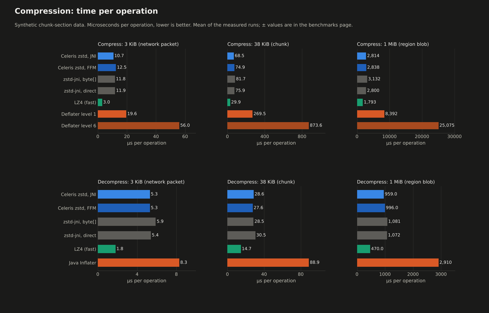
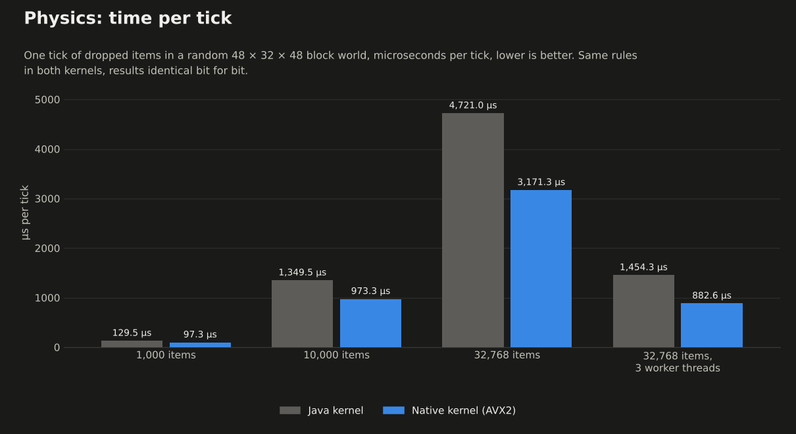
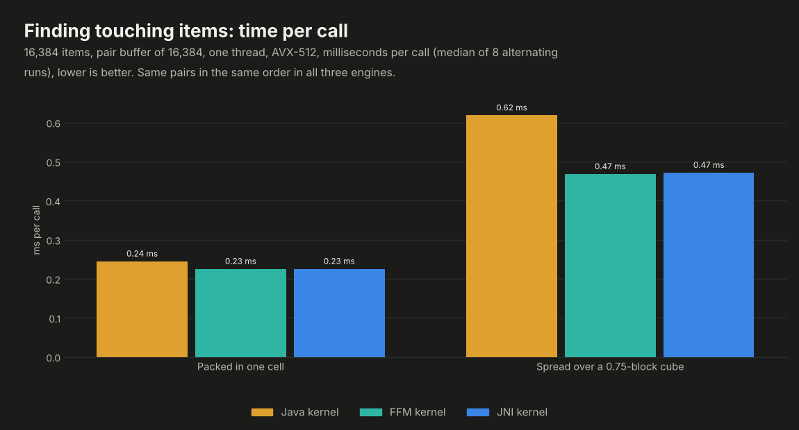
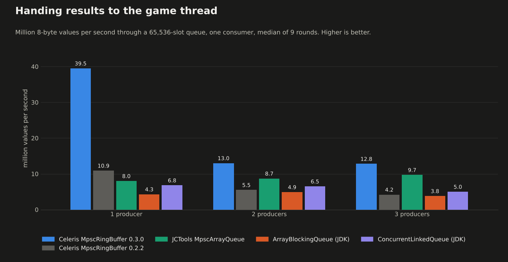

<p align="center">


</p>

> **Celeris is a performance library for NeoForge and Fabric mods.** It gives other mods fast building blocks so they can do heavy work without slowing the game down. On its own it adds nothing you can see in game: you install it because a mod you want needs it.

## 🎮 Mods that use it

| Mod | What it does for you |
|---|---|
| 🧱 **[Tessera](https://github.com/PanzerDevOrg/Tessera)** | Shrinks Minecraft's textures on the graphics card by **up to 75%**, with no visible difference. |

## ⚡ What it gives those mods

- 🧵 **Work off the main thread.** Mods hand heavy jobs to worker threads and get the results back on the game
  thread through lock-free queues, without stalling a tick or a frame.
- 🧠 **Less garbage-collector pressure.** Large buffers live in off-heap memory, so big data does not cause GC
  pauses.
- 📐 **Vector math.** Bulk number crunching uses the CPU's SIMD units when Java allows it, with identical results
  when it does not.
- 🗜️ **Compression.** Native zstd for mods' own data (no JVM flags needed), and deflate for network packets.
- 📦 **Items in pipes.** Pipe networks that carry items from block to block, drawn without an entity per item, and
  that keep the items when pipes are placed, broken or saved.
- 🏃 **Batch physics.** Thousands of entities moved in one pass, following vanilla's movement rules exactly.

## 🛡️ Safe everywhere

- ✅ Every fast path has a pure-Java fallback. If something can't run the fast way on your machine, Celeris uses
  the slower one instead of crashing.
- ✅ Optional on both sides of a connection: players without Celeris can join a server that has it, and you can join
  any server with it. A Fabric client with Celeris can also join a NeoForge server with it.
- ✅ Network payloads are size-capped and malformed packets are dropped.

## 🏁 How fast

Each building block, measured against what a mod would otherwise use (JMH, Java 21, a 4-core machine; full tables,
method and the costs too in [the benchmarks page](./docs/benchmarks.md)):

- 🗜️ **12.8× faster compression** than Java's built-in deflate (what Minecraft uses) for nearly the same size, and
  **3.1× faster decompression**. As fast as zstd-jni, the usual Java zstd library, in a jar a quarter of its size.
- 🏃 **32,768 dropped items moved in 0.88 ms** per tick on 3 threads with the native kernel, 5.3× faster than the
  same rules in Java on one thread and under 2 % of a tick.
- 🧲 **Item piles no longer stall**: finding the touching items in a pile of 16,384 takes 0.24 ms instead of up to a
  second.
- 🧵 **4.9× faster hand-off** from one worker thread to the game thread than JCTools, the go-to lock-free queue
  library, and still ahead with two or three workers.






## 📦 Requirements

- 🟩 **Minecraft:** 1.21 - 26.3. Download the file made for your version.
- 🔶 **Loader:** NeoForge or Fabric (with [Fabric API](https://modrinth.com/mod/fabric-api)), on the client and on the server.
- ☕ **Java:** 21 for 1.21.x, 25 for 26.x.

## ⚙️ Settings

- **Network compression level** (0-9, default 1): how hard Celeris compresses the packets it sends. 0 sends them
  uncompressed (least CPU, most bandwidth), 1 is the fastest, 9 gives the smallest packets. Only the sender's setting
  matters, so a server and its players can each pick their own.
  - **NeoForge:** Mods → Celeris → Config, or `compressionLevel` in `config/celeris-common.toml`. Takes effect on the
    next packet.
  - **Fabric:** with [Mod Menu](https://modrinth.com/mod/modmenu), Mods → Celeris → Config (takes effect on the next
    packet); or `compressionLevel` in `config/celeris.properties` (created on first start; restart after editing it
    by hand).

## 🔧 Native code

Celeris ships two kinds of native libraries, both built from public source by GitHub Actions on each platform's own
runner, from the same tagged commit as every file published here:

- **zstd 1.5.7** (Meta's Zstandard, BSD-3-Clause), compiled from the official release tarball
  ([`zstd-1.5.7.tar.gz`](https://github.com/facebook/zstd/releases/tag/v1.5.7), SHA-256 `eb33e51f…6fa3`, checked
  by the build), plus a few small functions of Celeris's own that let Java 21 call it without extra flags:
  [`native/zstd`](https://github.com/PanzerDevOrg/Celeris/tree/master/native/zstd).
- **The physics kernel**, Celeris's own C++ code: [`native/`](https://github.com/PanzerDevOrg/Celeris/tree/master/native).

The release workflow builds them, packs the jars and uploads them here; GitHub releases also carry a Java-only file
with no native code at all.

## 📚 Learn more

Speed tips, how it works, the full version list and the guide for mod authors are on GitHub.

<p align="center">
<a href="https://github.com/PanzerDevOrg/Celeris"></a>
<a href="https://github.com/PanzerDevOrg/Celeris/issues"></a>
<a href="https://github.com/PanzerDevOrg/Celeris/tree/master/docs/changelogs"></a>
</p>

<!-- publish:off -->

## What's inside

| | |
|---|---|
| **Memory** | FFM on Java 22+, `Unsafe` on 21, plain heap as a last resort |
| **Threads** | `MpscRingBuffer` and `AsyncResultQueue`: workers produce, the tick consumes |
| **Math** | `jdk.incubator.vector` when the module is loaded; the scalar path gives bit-identical results |
| **Compression** | Native zstd (FFM on Java 25 or with `--enable-preview`, JNI otherwise; contexts pooled across calls) and deflate, plus a compressed payload type for custom packets |
| **Graphs** | Segmented networks (pipes, wires) and discrete ones (signals), with pipeline solvers, including item transport |
| **Physics** | Batch bodies on a native kernel (AVX2, AVX-512, NEON) or in Java, following vanilla's movement rules |

Packets between client and server always use deflate, so a Java 21 client and a Java 25 server never disagree on the
format. Oversized or malformed payloads are dropped, not trusted.

## Files per version

| Minecraft | File | Java |
|---|---|---|
| 1.21 - 1.21.6 | `celeris-<version>+1.21.1.jar` | 21 |
| 1.21.7 - 1.21.10 | `celeris-<version>+1.21.10.jar` | 21 |
| 1.21.11 | `celeris-<version>+1.21.11.jar` | 21 |
| 26.1 - 26.3 | `celeris-<version>+26.1.jar` | 25 |

These are the NeoForge files; the Fabric file for each row ends in `-fabric.jar` (`celeris-<version>+1.21.1-fabric.jar`)
and needs Fabric Loader 0.16+ and Fabric API. Client and server. Each jar has been booted on every Minecraft version in its row. The
GitHub releases also carry per-system builds (Windows, Linux, macOS, or Java only) if you'd rather not ship natives
you won't load.

## JVM flags (optional)

None are required. These open the fast paths that the JVM keeps closed by default:

| Java | JVM arguments | Opens |
|---|---|---|
| 21 (Minecraft 1.21.x) | `--enable-preview --add-modules=jdk.incubator.vector` | FFM memory, SIMD (native physics and native zstd work without flags, over JNI) |
| 25 (Minecraft 26.x) | `--add-modules=jdk.incubator.vector` | SIMD (the rest is already open on 25) |

On NeoForge, leave `--enable-native-access` out: NeoForge loads mods as named modules that the flag cannot cover, and on
Java 21 it then blocks their FFM calls (native physics and zstd keep working: both use JNI, which the flag does not affect).
Fabric loads mods on the class path, so there `--enable-native-access=ALL-UNNAMED` is harmless and silences the JVM's
native-access warnings.

Modrinth App: *Settings → Java and memory*. CurseForge: *Settings → Minecraft → Additional arguments*. Prism: instance
*Settings → Java*. Servers: `user_jvm_args.txt`. `--enable-preview` belongs to Java 21 only.

## For mod authors

```kotlin
repositories {
    maven("https://panzerdevorg.github.io/Celeris/maven") {
        content { includeGroup("com.panzer.mods") }
    }
}
dependencies {
    implementation("com.panzer.mods:celeris-1.21.1:0.3.1") // NeoForge: celeris-<minecraft version>
    // Fabric (Loom): modImplementation("com.panzer.mods:celeris-1.21.1-fabric:0.3.1")
}
```

Source, examples and the package map: **[github.com/PanzerDevOrg/Celeris](https://github.com/PanzerDevOrg/Celeris)**

## Package overview

| Package | Contents |
|---|---|
| `core.memory.backend` | `MemoryBackend` with automatic selection: **FFM** → **Unsafe** → **heap** |
| `core.memory` | `PacketPipeline`, `MemoryBus`, zstd (native) / deflate compression codecs |
| `core.concurrency` | `MpscRingBuffer`: lock-free multi-producer/single-consumer ring on off-heap memory |
| `framework.async` | `AsyncResultQueue`: hand results from worker threads to the game/render thread |
| `framework.ticking` | `IdleTickFilter`: skip work while nothing is pending |
| `framework.capability/query` | Capability caching and throttled queries |
| `api.simd` | `VectorOperations`: SIMD via `jdk.incubator.vector`, scalar fallback with identical results |
| `core.topology`, `graph.*` | Network topology plus segmented (pipes, wires) and discrete (per-node signal) graphs |
| `pipeline.*` | Event-driven and continuous (SIMD) pipeline solvers; `pipeline.transit`: item transport (`TransitSolver`, routers, migration, persistence) |
| `api.transit` | What a client needs to draw transported items: `TransitMotion`, `TransitDelta`, `ClientItemTable` |
| `network` | `PayloadCompression` / `CompressedPayload`: compressed custom payloads; `TransitDeltaPackets` for item messages |
| `physics` | Batch physics engine: SoA bodies, native C++ kernel or pure-Java kernel, broadphase, entity bridge ([`native/`](./native)) |

Everything is chosen at startup and logged once. `-Dceleris.compatMode=true` forces the pure-Java paths.

## Using Celeris in your mod

Declare it as a required dependency in your `neoforge.mods.toml` (Fabric: `"depends": { "celeris": ">=0.3.1" }` in
`fabric.mod.json`):

```toml
[[dependencies.yourmod]]
modId = "celeris"
type = "required"
versionRange = "[0.2.0,)"
ordering = "AFTER"
side = "BOTH"
```

Quick example: offloading work and applying the results on the main thread.

```java
AsyncResultQueue<Result> results = new AsyncResultQueue<>(256); // capacity: power of two
// worker thread
results.offer(computeResult());
// game/render thread, once per tick
results.drainTo(this::apply, 32);
```

Quick example: items in pipes (server tick, then what to send players).

```java
var migrator = new TransitMigrator((handle, speed, nodeRaw) -> dropInWorld(handle, nodeRaw));
var graph = new SegmentedGraphImpl<>(topology, TransitPayload::new, migrator); // pipes keep their items when edited
var solver = new TransitSolver(TransitConfig.defaults(), new RoundRobinRouter(), endpoints, migrator);
solver.bind(graph);
var recorder = new TransitDeltaRecorder(0L, bytes -> send(TransitDeltaPackets.encode(bytes)));
solver.setEvents(recorder);
migrator.setEvents(recorder, solver::tickCount);

graph.addNodes(ids, masks, count);      // a whole chunk of pipes in one pass
solver.insert(node, direction, handle); // an item enters the pipe leaving `node`
solver.tick();                          // once per server tick
recorder.drain(solver.tickCount());     // sends only what changed
// client: TransitDeltaPackets.decode(payload, clientItemTable); position = TransitMotion.progress(...)
```

All of it runs on one thread (normally the server thread) and has a pure-Java path. More complete, runnable examples (pipes, wires, ring buffer, compressor, memory bank) live in
[`example/`](./example).

## Building

Clone the shared build logic next to Celeris; the build reads it from `../panzer-build-logic`:

```bash
git clone https://github.com/PanzerDevOrg/PanzerBuildLogic.git panzer-build-logic
git clone https://github.com/PanzerDevOrg/Celeris.git
cd Celeris
```

The folder must be called `panzer-build-logic` and sit next to `Celeris` (hence the explicit name in the first clone).
Without it the build stops at once with `panzer-build-logic not found at <path>` and the clone command to run.
To reproduce exactly what CI built for a commit, check panzer-build-logic out at the commit pinned in
[`.github/workflows/ci.yml`](./.github/workflows/ci.yml) (`mod-ci.yml@<sha>`):

```bash
git -C ../panzer-build-logic checkout "$(grep -oE 'mod-ci.yml@[0-9a-f]{40}' .github/workflows/ci.yml | cut -d@ -f2)"
```

Requirements: JDK 25 to run Gradle (Fabric Loom needs it); JDK 21 for the 1.21.x targets is downloaded automatically
through Gradle toolchains. `-Ppanzer.loaders=neoforge` (or `fabric`) builds one loader only.

```bash
./gradlew build                     # every Minecraft version, with tests
./gradlew :1.21.1:runClient         # dev client for one version (NeoForge)
./gradlew :1.21.1-fabric:runClient  # the same on Fabric
./gradlew publishToMavenLocal       # use your local build from other mods (never implied by build)
./gradlew benchmarkTest             # ring buffer throughput comparison (not part of build/check)
./gradlew buildAndCollect           # release jars (universal, per-system, sources) in build/libs/<version>/
```

Both native libraries are built with CMake: zstd 1.5.7 from its official release tarball ([`native/zstd`](./native/zstd),
`./gradlew buildNativeZstd`) and the physics kernel from [`native/`](./native) (`./gradlew buildNativeCelerisPhysics`),
or both with `-Ppanzer.native.build=true` on any build. CI builds them for every platform and bundles those builds
into the released jars; a local build without them uses deflate and the Java physics kernel.

**Native libraries are never committed.** `natives/<os>/<arch>/` is build output (ignored by git): CMake writes it
locally with `-Ppanzer.native.build=true`, and CI writes it from the per-platform native jobs before packaging, so a
released jar always carries libraries built from the sources of the same commit; nothing prebuilt in the repository
can drift from them. The kernel is built with `-ffp-contract=off` and without `-ffast-math` (IEEE parity with the
Java reference, checked by `PhysicsParityTest` on every ISA), plus `-fstack-protector-strong` and, on Linux, full
RELRO (`-z relro -z now`), which change no arithmetic.

## Releasing

This README is the description on Modrinth and CurseForge too (everything outside `publish:off` blocks); see
[`docs/README.md`](./docs/README.md). To release: add `docs/changelogs/<version>.md`, set `version` under `[mod]` in
`mod.stonecutter.properties.toml`, commit, then push a matching tag:

```bash
git tag v0.2.0 && git push origin v0.2.0
```

CI publishes the Maven repository, a GitHub release with every jar, and the Modrinth and CurseForge files. Every other
push runs the same release as a dry run and uploads a `release-preview` artifact with the pages as they would look.

<!-- panzer:license -->
## License

| Content | License |
|---|---|
| Source code | [AGPL-3.0](https://www.gnu.org/licenses/agpl-3.0.html), see [`LICENSE-AGPL`](./LICENSE-AGPL) |
| Artwork, branding and documentation | [CC BY-NC-SA 4.0](https://creativecommons.org/licenses/by-nc-sa/4.0/), see [`LICENSE-CC`](./LICENSE-CC) |
| Zstandard (zstd) (bundled) | [BSD-3-Clause](https://github.com/facebook/zstd), see [`NOTICE`](./NOTICE) |

**Source code:** you may study, modify and redistribute it under the AGPL; if you run a modified version as a network service, its source must be available to that service's users.

**Artwork:** credit Panzer, no commercial use without permission, and share derivatives under the same license.

See [`LICENSE`](./LICENSE) for the full summary.
<!-- /panzer:license -->

<!-- publish:on -->

---

<!-- panzer:footer -->
Code: **AGPL-3.0** · Art: **CC BY-NC-SA 4.0** · Made by **Panzer**
<!-- /panzer:footer -->
